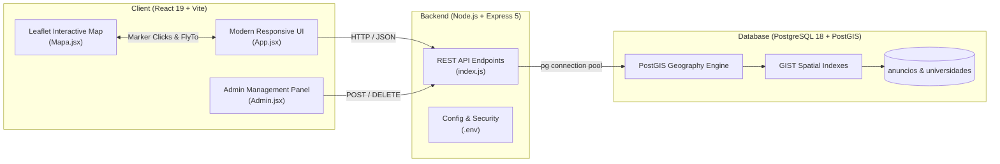

# UniStay Coimbra 🏠🎓
### Geospatial University Housing Discovery Platform

[](https://react.dev/)
[](https://vitejs.dev/)
[](https://nodejs.org/)
[](https://www.postgresql.org/)
[](https://postgis.net/)
[](https://leafletjs.com/)
[](LICENSE)

An independent full-stack geospatial web application designed to help university students in Coimbra find rooms, suites, and studios within precise walking distance of their respective university campuses.

Developed by **João Bernardo Libório Graça ([@joaoblg](https://github.com/joaoblg))**.

---

## 🌟 Key Highlights

- 📍 **Real GPS PostGIS Geodesics**: Eliminates guesswork by calculating exact walking distance and estimated walk times (`ST_Distance` over `geography(Point, 4326)`) rather than superficial estimates.
- 🗺️ **Interactive Geovisualization**: Built with Leaflet & CARTO Voyager basemaps featuring custom Airbnb-style dynamic price badges, pulsing campus pins, and proximity radius visualization.
- 🎯 **Campus-Centric Filtering**: Instant 1-click filtering by major Coimbra campuses:
  - **ISEC** (*Vale das Flores • Engenharia & Tecnologia*)
  - **UC Polo I** (*Alta Universitária • Letras, Direito, Ciências*)
  - **UC Polo II** (*Pinhal de Marrocos • Engenharias FCTUC*)
  - **UC Polo III** (*Celas • Medicina, Farmácia, Ciências da Saúde*)
  - **FEUC** (*Olivais • Economia, Gestão, Sociologia*)
  - **ESEC** (*Solum • Educação, Comunicação, Desporto*)
- ⚡ **Synchronized Map & Grid UI**: Clicking any accommodation card smoothly flies the camera to the listing, highlights the price badge, and opens its detail popup with direct links to original verified portals (OLX, Idealista, etc.).
- ⚙️ **Integrated Admin & Management Portal**: Complete dashboard for landlords and administrators to register new listings with automated GPS coordinate presets, monitor average rental prices, and manage active housing records.

---

## 🏗️ Architecture & Tech Stack



### Core Technologies
- **Frontend**: React 19, Vite, Leaflet, React-Leaflet, Lucide React, Modern CSS3 with Glassmorphism & Custom CSS variables.
- **Backend**: Node.js, Express 5, `pg` (Node-Postgres Connection Pool), `dotenv`, `cors`.
- **Database & Spatial Engine**: PostgreSQL 18 with PostGIS extension, utilizing `ST_MakePoint`, `ST_SetSRID`, `ST_DWithin`, and `ST_Distance` with GIST spatial indexing.

---

## 🔌 API Specification

| Method | Endpoint | Description | Query Parameters |
|:-------|:---------|:------------|:-----------------|
| `GET` | `/health` | Service uptime and status check | None |
| `GET` | `/universidades` | List all Coimbra campuses with exact GPS coordinates | None |
| `GET` | `/quartos` | Find accommodations ordered by walking distance | `lat`, `lon`, `raio` (default 2500m), `maxPrice`, `tipo` |
| `GET` | `/quartos/todos` | Retrieve all active accommodations in the city | None |
| `POST` | `/quartos` | Create and index a new accommodation | Body: `titulo`, `preco`, `tipo`, `despesas_incluidas`, `link_original`, `imagem_url`, `lat`, `lon` |
| `DELETE`| `/quartos/:id` | Remove an accommodation by ID | Path param: `id` |

---

## 🚀 Getting Started

### Prerequisites
- [Node.js](https://nodejs.org/) (v18 or higher)
- [PostgreSQL](https://www.postgresql.org/) (v14 or higher) with [PostGIS extension](https://postgis.net/) installed

### 1. Database Setup
Create database and load schema & seed data:
```bash
# Connect to PostgreSQL
psql -U postgres -c "CREATE DATABASE unistay_db;"

# Apply schema with PostGIS extension and GIST indexes
psql -U postgres -d unistay_db -f database/schema.sql

# Seed Coimbra campuses and initial accommodations
psql -U postgres -d unistay_db -f database/seed.sql
```

### 2. Backend Setup
```bash
cd Servidor

# Copy environment template
cp .env.example .env

# Edit .env with your PostgreSQL credentials
# PORT=3000
# DB_USER=postgres
# DB_PASSWORD=your_password
# DB_HOST=localhost
# DB_PORT=5432
# DB_NAME=unistay_db

# Install dependencies and start server
npm install
node index.js
```

### 3. Frontend Setup
```bash
cd client

# Install dependencies
npm install

# Start development server
npm run dev
```

Visit `http://localhost:5173` to explore UniStay Coimbra.

---

## 👤 Author
- **João Bernardo Libório Graça** ([@joaoblg](https://github.com/joaoblg))
- Email: `jonygraca6@gmail.com`
